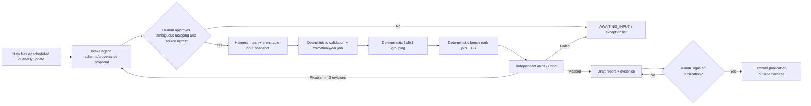

# Design note: persistent DGTW fund-attribution workflow

## Task, user and recurring trigger

The intended user is a buy-side fund analyst reviewing each newly disclosed quarterly portfolio. The current manual process is to inspect holdings, join stock-year characteristics, look up 125 CSMAR-style characteristic groups, subtract group-period benchmark returns, weight contributions, and write a memo. Spreadsheet formulas are fragile when schemas, dates or missing observations change. A new disclosure or corrected source extract triggers a new immutable run. A persistent system is necessary because input clarification, enrichment, independent review and report sign-off may span days; interruption must not repeat or silently alter completed stages.

**Permitted sources:** analyst-supplied and authorized local data only. No autonomous web retrieval of benchmark data; no trade execution. Information cutoff is the formation date for characteristic assignment and the end of the forward return period for ex-post CS. A backtest must never use characteristics learned after formation. The synthetic example meets the stated timing contract. The teaching workbook's timing and B/M definition remain unresolved.

## Annotated workflow

**Handoffs:** Intake produces an approved mapping/config and source manifest; grouping produces `groups.json` with selected boundaries and reason codes; attribution produces stock-level and quarterly rows; Critic produces an independent audit verdict; reporting reads only audited artifacts. Codex skills specify reasoning work, while the harness owns stage transitions, retries, caching and permissions. No agent can override a failed hard check in prose.

## Finance calculation

For each holding stock *i* and return period *t*, classify the formation-year size, B/M and momentum using CSMAR-style hierarchical 5×5×5 maximum boundaries. The input must state whether B/M is raw or industry-adjusted; benchmark groups and features must use the same definition. Group IDs in the supplied CSMAR file run 1 = high to 5 = low. The calculation is

`CS_t = Σ_i w_(i,t-1) × [r_(i,t) − R_(size_i,BM_i,MOM_i,t)]`.

The system does not rebalance weights to 100%; it discloses covered weight and cannot infer whole-fund alpha from partial disclosed holdings. Missing characteristics or returns remain exceptions, never zero. Source backfill creates a new snapshot and run, not an in-place edit. Statistical imputation is excluded from the main result; any sensitivity study must be separately labeled.

## Harness and checkpoints

`run` creates a UUID run directory, persists a SHA-256 manifest of every source plus config, and atomically writes stage outputs followed by state. Stages are `validated → grouped → calculated → audited → reported`. `resume` verifies all hashes and prior checkpoint hashes before skipping a completed stage. Semantic failures stop as `BLOCKED`; transient file-read errors may be retried at most twice. `--stop-after` is a reproducible interruption test. The controller has no network or write access outside its chosen run directory, except reading approved inputs. Input size and row limits bound resource use; no model/API calls occur in the deterministic path, so token cost is zero. Codex-assisted triage is explicitly human-initiated and capped at one review plus two revisions per run.

## Independent verification, change control and rollback

Audit recomputes stock contributions from the input checkpoint and checks unique keys, quarter sums, completeness, temporal ordering, coverage, NaN/zero substitution and report assertions. A fixed eval suite covers boundary assignment, missing values, units, future-data leakage, duplicate keys, workbook adaptation, recovery, and input mutation. `evals/baseline.json` is the accepted reference. Proposed changes are tested against that baseline; a regression blocks adoption. Version/commit and eval metrics are recorded in `docs/build-log.md`; rollback uses the previous Git commit/tag, not an LLM assertion. A person reviews any new source mapping, methodology change, publication or operational action.

## Acceptance and limitations

Accept a draft only when inputs pass the contract, all stock-level arithmetic reconciles, there is no temporal leakage, and each quarterly coverage is at least the configured threshold. The output must show covered weight and unresolved exceptions. Reports are research assistance, not investment recommendations. CSMAR licensing may prohibit redistribution; real workbooks are excluded from Git and ZIP. This is CS only—not CT/AS, causal manager skill, true fund NAV attribution, or an investable strategy. Full independent reproduction of CSMAR's industry adjustment requires its exact source definition and underlying fields, which are not supplied in the course example.

**Methods:** [Daniel, Grinblatt, Titman & Wermers (1997)](https://terpconnect.umd.edu/~wermers/ftpsite/Dgtw/dgtw.pdf); [benchmark construction notes](https://terpconnect.umd.edu/~wermers/ftpsite/Dgtw/coverpage.htm). CSMAR-specific definitions must still be verified against the licensed data dictionary.

